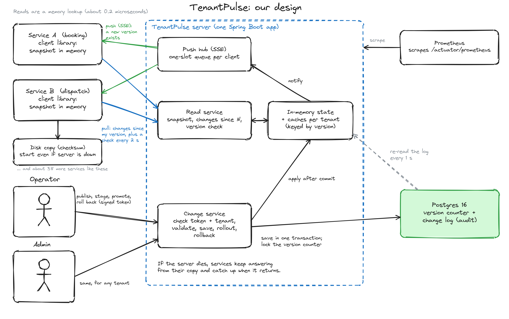

# TenantPulse

Hierarchical tenant configuration with live propagation, built for the MoveInSync backend case study (Case Study 2).

A **config server** stores settings at four levels – `GLOBAL → CLIENT → OFFICE → SHIFT`, most specific wins – and a
**client library** that every other service embeds keeps an in-memory copy. Reads are a memory lookup (no network),
and a published change reaches every connected client within seconds.



* Design note with diagrams and the failure-mode table: **[docs/design-note.md](docs/design-note.md)**
* Java 21, Spring Boot 3.4, Postgres 16, Maven multi-module.

## The case study's key points

| Asks | Answer in one line | Where |
|---|---|---|
| Consistency model | One writer, bounded staleness, never mixed, never backwards. | [design note §3](docs/design-note.md) |
| Version 41 after 43 | Ignored: the version never moves back. | `VersionOrderingTest` |
| Atomic change sets | A change set is applied whole, by swapping one reference. | `ConfigSnapshotConcurrencyTest`, `ClientAtomicityTest` |
| Prove it | Read 0.18 µs; 200 clients p50 57 ms, p99 258 ms; server killed and recovered. | [Measured performance](#measured-performance), `scripts/kill-the-server-demo.sh` |

## Run it (one command)

```bash
docker compose up --build
```

This starts Postgres and the server. Open **http://localhost:8080** for the demo console: change a setting and watch
the values a service sees update live, stage a rollout, roll back, or kill the server and see reads keep working.

For the demo the server runs with a token endpoint switched
on; see *Security* below. Prefer to run the server from Maven? Start only the database and the server:

```bash
docker compose up -d postgres            # Postgres on localhost:5436
mvn -DskipTests install
mvn -pl tenantpulse-server spring-boot:run -Dspring-boot.run.arguments=--tenantpulse.security.dev-token-endpoint-enabled=true
```

(Port 5436 is used if you want to change it then use `TENANTPULSE_DB_PORT`.)

## Try the example

An operator changes the Bengaluru office's booking cut-off from 60 to 30 minutes; only that office changes.

```bash
B=http://localhost:8080
tok() { curl -s -X POST $B/dev/token -H 'Content-Type: application/json' \
          -d "{\"subject\":\"$1\",\"role\":\"$2\",\"tenant\":\"$3\"}" | sed 's/.*"token":"\([^"]*\)".*/\1/'; }
OP=$(tok op-ravi OPERATOR acme)
SVC=$(tok booking-svc SERVICE acme)

curl -s -X POST $B/v1/change-sets -H "Authorization: Bearer $OP" -H 'Content-Type: application/json' -d '{
  "reason": "festival rush",
  "changes": [{"key":"booking.cutoff.minutes","scope":{"level":"OFFICE","clientId":"acme","officeId":"blr"},"value":"30"}]}'

curl -s -H "Authorization: Bearer $SVC" "$B/v1/config/booking.cutoff.minutes?office=blr"    # 30
curl -s -H "Authorization: Bearer $SVC" "$B/v1/config/booking.cutoff.minutes?office=pune"   # still 60
```

`scripts/demo-example.sh` runs the full walk-through: this example plus a rejected bad value, tenant isolation, a staged
rollout with promote, and a rollback with its diff.

## API

| Method and path | Who | What |
|---|---|---|
| `POST /v1/change-sets` | operator, admin | Publish a change set (atomic: all values or none). Returns the new version. |
| `POST /v1/rollouts` · `POST /v1/rollouts/{id}/promote` | operator, admin | Stage a change on chosen offices; promote it to the whole client. |
| `POST /v1/rollbacks` | operator, admin | Restore the state of an earlier version as a new version; returns the diff. `dryRun` previews it. |
| `GET /v1/config` · `GET /v1/config/{key}?office=&shift=` | any role | Resolved values; `level`/`scope`/`version` show which level supplied each (explain mode). |
| `GET /v1/snapshot` · `GET /v1/changes?since=N` · `GET /v1/version` | any role | What the client library uses to start, catch up, and check. |
| `GET /v1/stream` | any role | Live push (server-sent events): "version N exists". |
| `GET /actuator/prometheus` · `/actuator/health` | open | Metrics and health. |

Errors always have the same shape: `{"error": "...", "message": "...", "details": [...]}`; they never echo submitted values.

## The client library

```java
TenantPulseClient client = TenantPulseClient.create(
        ClientConfig.builder(URI.create("http://config:8080"), "acme", tokens::current)
                .cacheFile(Path.of("/var/lib/booking/tenantpulse.cache"))   // start-up copy when the server is down
                .build());
client.start();

long cutoff = client.getLong("booking.cutoff.minutes", "blr");        // memory lookup, no network

ResolvedSetting why = client.explain("booking.cutoff.minutes", "blr", null);

ConfigView view = client.view();      // when several settings must agree (a window's start and end),
view.get("night.start", "blr", null, Long.class);   // read them all from one view
```

It never calls the server on a read, never lets a reader see half of a change set, never moves to an older version,
keeps serving its last snapshot if the server dies, and starts from a checksummed disk copy when the server is down.
`client.metrics()` exposes counters (pushes, ignored stale messages, sync failures, reconnects, disk-copy problems).

## Tests

All 154 tests pass with `mvn clean install` (the Postgres tests need Docker).

## Measured performance

Machine: Intel Core i5-12500H (12 cores / 16 threads), 14.5 GB RAM, Ubuntu 26.04 (Linux 7.0), OpenJDK 21.0.12, Postgres 16
in Docker on the same machine, server and load generators on the same host (so network cost is loopback only).

**Local reads** (`LocalReadBenchmark`, JMH, 500 settings with overrides at client, office and shift level; a `getLong`
through the client; no server involved):

| Scenario | Throughput | p50 | p99 | p99.9 |
|---|---|---|---|---|
| Office-level override, 1 thread | ≈ 8 M reads/s | 179 ns | 291 ns | 4.2 µs |
| Same read through a `ConfigView` the caller already holds, 1 thread | ≈ 8 M reads/s | 174 ns | 302 ns | 4.4 µs |
| Worst case: no override, all four levels checked then the default, 1 thread | ≈ 2 M reads/s | 479 ns | 736 ns | 4.2 µs |
| Office-level override, **8 threads** reading at once | ≈ 39 M reads/s in total (about 5× one thread) | 288 ns | 352 ns | 7.3 µs |

So a read costs a fraction of a microsecond with no network call and no lock, and reads scale across threads because
they share nothing but an immutable snapshot. (JMH `SampleTime` includes the timer's own cost of a few tens of
nanoseconds; the p99.9 and above are dominated by garbage collection and OS scheduling, not by the lookup.) The worst case
is slower because each lookup builds the list of scopes to try; that allocation is the obvious next optimisation if reads
ever needed to be faster than this.

**Propagation to 200 simulated clients** (`PropagationTo200ClientsRunner`: 200 clients each with a live connection, 20 rounds,
clock starts just before the publish request is sent, so it includes the database commit; the 200 clients share one
load-generator JVM):

| | p50 | p99 | max |
|---|---|---|---|
| time until a client returns the new value (4,000 observations) | 57 ms | 258 ms (the cold first round; later rounds 48–164 ms) | 284 ms |

The requirement is 5,000 ms. (The 2-second version check was also running during this benchmark, so a few clients may have
been reached by it first. The push path on its own is proven by `EndToEndPropagationTest`, which sets the check to one
minute so only the push can deliver the change.)

**Reconnect storm** (`ReconnectStormRunner`: 500 clients start at the same instant with nothing cached): all 500 got a
snapshot in 1.8 s with 0 failures at the default limit (64 concurrent resyncs). With the limit squeezed to 2 to force the
protection to engage, the server answered "busy, retry shortly" (HTTP 429) 42 times, all 500 clients still succeeded (2.4 s)
and the server logged no errors.

Where it stops scaling: see section 8 of the design note (publishing is serialised by one row lock; every server instance
holds all tenants in memory; push connections per instance; rollback replays the log).

## Monitoring

`/actuator/prometheus` on the server, in addition to the standard HTTP, JVM and connection-pool metrics:

| Metric | Answers |
|---|---|
| `tenantpulse_client_lag_versions` (p50/p99) | How far behind are clients? (clients report their version on each check) |
| `tenantpulse_config_version` | Is this server applying changes? |
| `tenantpulse_publish_total{result=accepted,duplicate,rejected}` | Publish rate, **rejections**, and **retries** (duplicates are retried requests) |
| `tenantpulse_resync_rejected_total` | Is a reconnect storm being throttled? |
| `tenantpulse_sse_connections`, `..._queue_depth`, `..._notifications_total`, `..._send_failed_total`, `..._rejected_total` | Push health: connections, **queue depth**, failures, refusals at the cap |
| `tenantpulse_errors_total{type=...}` | **Error rate** by kind (rejected, forbidden, unauthenticated, bad_request, internal…) |
| `tenantpulse_refresh_failed_total` | Could the server read storage? |

Logs are structured JSON (one object per line) and carry ids only: no values, emails, phone numbers or locations. The client
library exposes its own counters through `client.metrics()` for the host service to export.

## Security

* Signed (HS256) bearer tokens with `sub`, `role` and `tenant`. Roles: `SERVICE`, `EMPLOYEE` (read, own tenant), `OPERATOR`
  (change own tenant), `ADMIN` (any tenant and GLOBAL). Clock tolerance is 10 s; tokens without a subject or expiry are refused.
* Tenant isolation is decided in one place (`TenantAccessPolicy`) and covered for every read path, writes, rollouts, rollbacks and the push stream.
* The author of a change is the caller, never a request field.
* **Set `TENANTPULSE_JWT_SECRET` (32+ bytes) in any real deployment.** The built-in default is for local use and logs a warning.
  The token-minting endpoint `/dev/token` exists only when `TENANTPULSE_DEV_TOKEN_ENDPOINT=true` (the compose file turns it on for the demo).
  In production tokens come from your identity provider with the same claims.

## Trade-offs, assumptions and what is left out

Full discussion in [the design note](docs/design-note.md). In short:

* **Availability and latency over strict consistency**: clients can be a few seconds behind and keep serving when the server is down.
* **Push is a hint, polling is the guarantee**: one extra round trip per change in return for correctness under lost, duplicate and reordered messages.
* **One lock for versions**: provably ordered, limits writes to hundreds per second (plenty for configuration).
* **Assumptions**: setting definitions are code (`SettingCatalog`: booking cut-off, max ride, night window, escort rule, cab types);
  numbers are whole numbers; a time window may wrap past midnight only for settings declared to allow it (the night window does);
  an office id is unique within its client.
* **Left out deliberately**: definitions in the database, a production UI (only a small demo console is served at `/`), an identity provider, multi-region, log compaction, Redis/Kafka
  fan-out (several server instances already stay in step through Postgres within ~1 s), detection of a server restored from an
  older backup (clients refuse to go backwards and keep serving; a diverged history needs an operator).
