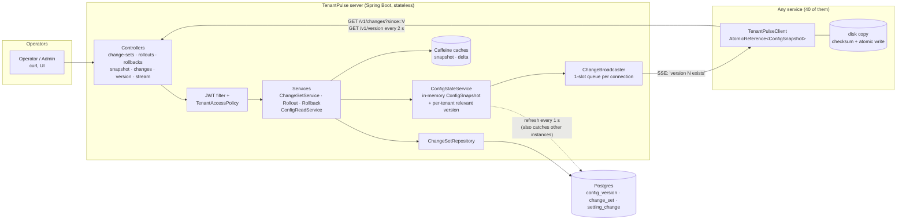

# TenantPulse – design note

Hierarchical tenant configuration with live propagation: a config server plus a client library that every service
embeds. Reads are answered from memory; changes reach every connected client within seconds.

## 1. Architecture



* **Core** (`tenantpulse-core`): plain Java – types, resolution, validation, the immutable snapshot, diff. No Spring, no DB.
* **Server**: controllers (HTTP only) → services (rules) → repository (storage). Postgres is the only state.
* **Client**: a local snapshot read with one volatile read; a background synchronizer keeps it current.

## 2. Data model

| Table | Purpose |
|---|---|
| `config_version` | One row, the version counter. Publishers lock it, so versions are handed out one at a time and become visible in order. |
| `change_set` | One row per published change set: version (PK), author, reason, idempotency key (unique), kind (`PUBLISH`, `ROLLOUT_STAGE`, `ROLLOUT_PROMOTE`, `ROLLBACK`), reference version, time. Append-only: the audit log. |
| `setting_change` | The edits of a change set: key, scope level/client/office/shift, value (null = remove the override). |

Setting *definitions* (key, type, validation rules, global default) live in code (`SettingCatalog`); see trade-offs.

## 3. Consistency model (one paragraph)

TenantPulse is a one-way replication system with a single writer. The server's log is the source of truth; every client
holds a copy that is *eventually consistent with a bounded delay*: a published change is visible in every connected client
within one version-check interval (2 s by default, plus network time), usually within a few hundred milliseconds because of
the push. A client moves between whole, committed states only (a change set is applied as one unit by swapping a single
reference), so it can be behind but never wrong or mixed; it never moves backwards; and two clients that have applied the
same version hold identical data for their tenant. We deliberately choose availability and latency over strict
consistency: a client with no server keeps answering from its last good snapshot instead of failing.

## 4. Versions only move forward — what a client does with 41 after 43

* A push is only a **hint** ("version N exists"). The client never trusts its content; it fetches `changes?since=<my version>`.
* If N ≤ the client's current version the hint is **ignored** (counter `staleMessagesIgnored`). So 41 after 43, and a
  duplicate 43, change nothing: no value changes, the version does not step back.
* Even if a stale change set appeared inside a delta, the client skips any entry whose version is not above the one it
  already holds, and `ConfigSnapshot.apply` throws `StaleVersionException` for a non-increasing version.
* A snapshot older than the client's is **refused** (`backwardsSnapshotsRejected`). A server that is behind a client
  (for example restored from an old backup) never drags it back.
* Server side: the counter-row lock makes version order equal commit order, so a reader that has seen N has seen everything
  below N. (A Postgres `SEQUENCE` cannot promise that: it hands numbers out before commit.)

## 5. The hardest flow: publish and propagate

```mermaid
sequenceDiagram
    autonumber
    participant Op as Operator
    participant API as Server API
    participant Svc as ChangeSetService
    participant DB as Postgres
    participant St as ConfigStateService
    participant BC as ChangeBroadcaster
    participant C as Client (tenant acme)

    Op->>API: POST /v1/change-sets (token)
    API->>Svc: publish(caller, changeSet)
    Svc->>Svc: tenant policy check, validate every value
    alt a value is invalid
        Svc-->>Op: 422 with the list of problems (nothing stored, no version used)
    else valid
        Svc->>DB: BEGIN; lock config_version row
        Svc->>DB: idempotency key seen? (if so return the earlier version)
        Svc->>DB: version = version + 1; insert change_set + setting_change; COMMIT
        DB-->>Svc: version N (now durable)
        Svc->>St: refresh() – apply N to the in-memory snapshot
        St->>BC: notifyChange(N, affected tenants)
        BC-->>C: SSE event "version N" (only if the change concerns acme)
        Svc-->>Op: 200 { version: N }
        C->>API: GET /v1/changes?since=V (V < N)
        API-->>C: delta (only acme's changes)
        C->>C: apply whole change set to a NEW snapshot, then swap one reference
    end
    Note over C,API: If the push is lost, the 2 s version check (GET /v1/version) finds N and runs the same fetch.
    Note over DB,BC: Announce only after COMMIT. If the server dies between commit and push, nothing is lost: clients find N by the version check, and a restarted server rebuilds its state from Postgres.
```

## 6. Failure modes

| What fails | What the user / service sees | How the system recovers |
|---|---|---|
| Config server down or restarting | Reads keep working from the last snapshot. Writes fail (operators see an error). | Clients retry with exponential backoff + full jitter; on return they fetch only the delta. A restarted service starts from its disk copy. |
| Push lost, duplicated or reordered | Nothing wrong; at worst a delay of one check interval. | Pushes are hints; version rule ignores old/duplicate ones; the 2 s version check heals a miss. |
| Server dies right after committing, before pushing | The change is not pushed. | It is in Postgres. Clients find it by the version check or on reconnect (the new stream starts with the current version). |
| 500 clients reconnect at once | Some get "busy, retry shortly" (HTTP 429 + `Retry-After`). | Server caps concurrent resyncs; clients wait `Retry-After` + jitter; deltas are small and cached per tenant and version. |
| Invalid value (−30 min, window ending before start) | Operator gets 422 listing each problem. | Rejected before storage: no version used, nothing broadcast. |
| Two operators publish at the same moment | Both succeed, with different consecutive versions. | The counter-row lock serialises them. |
| Same request retried (timeout, double click) | Same version returned. | Idempotency key is checked under the same lock; unique index as a backstop. |
| Partial failure inside a change set | The whole change set is rejected or applied; never half. | One DB transaction on the server; one reference swap on the client. |
| Client falls too far behind (> 500 change sets) | Nothing visible. | Server answers `fullSnapshotRequired`; client loads the full snapshot. |
| Server has a setting the client does not know | Nothing visible. | Delta fails to apply → client loads a full snapshot (which carries the new definition). |
| Disk copy damaged, truncated or from another tenant | Nothing visible. | Checksum/tenant check fails → copy ignored, counted (`diskCacheCorrupt`), client fetches from the server. |
| Crash while writing the disk copy | Nothing visible. | Write goes to a temp file, is fsynced, then atomically renamed; a reader sees the old or the new file, never half. |
| No server and no disk copy at start-up | `start()` throws `ConfigUnavailableException` after the start-up timeout. | The service fails fast and is restarted by its orchestrator. |
| Half-dead push connection (network cut, no close) | Nothing visible. | Idle watchdog closes it after 45 s and the client reconnects; the version check covers the gap. |
| Slow or stuck push client | Other clients unaffected. | One-slot queue per connection holds only the newest version; sending runs on its own virtual thread; dead connections found by heartbeat. |
| Another tenant's data requested | 403. | Tenant bound to the token; every read path goes through `TenantAccessPolicy`. |
| Postgres down | Publishing fails with HTTP 500 and a generic message (details only in the server log); the health check reports DOWN. Clients' reads are unaffected, and so are their cached snapshots. | Normal DB recovery; the server's 1 s refresh resumes by itself. |

## 7. What can be stale, for how long, and how it is bounded

| Cache | What can be stale | Bound |
|---|---|---|
| Client snapshot | Any value, until the next sync. | ≤ one version-check interval (2 s ±10% jitter) + request time, for a connected client. Typically < 200 ms via push. Unbounded only while the server is unreachable (by design: availability over freshness). |
| Server in-memory state | Another instance's writes. | ≤ refresh interval (1 s). Own writes are applied immediately after commit. |
| Server snapshot/delta caches (Caffeine) | Nothing: keys include the version, so a new version is a new key. | Evicted by size (LRU) and age (10 min after access / 2 min after write). |
| Client disk copy | Everything, if the server was down long. | Only used at start-up; replaced by the first successful sync. |

## 8. Cost: time and space, and where it stops scaling

| Operation | Time | Space |
|---|---|---|
| Resolve a setting | O(levels) = 4 hash lookups | – |
| Apply a change set of *c* changes | O(K + Σ per-key overrides touched), K = keys that have overrides (copy of the outer map; untouched per-key maps are shared) | O(K) new map per change set |
| Client snapshot | – | O(definitions + overrides of its tenant) |
| Publish | O(c) + one commit | – |
| Delta for a tenant | O(change sets since V) | cached per (tenant, from, to) |
| Rollback diff | O(total change sets) to replay + O(overrides) to compare | O(overrides) |

It stops scaling at: **(1)** publish rate – publishers are serialised by one row lock, so throughput ≈ 1 / commit latency
(hundreds per second, ample for configuration changes, but not millions); **(2)** server memory – every instance holds all
tenants' overrides; **(3)** push connections per instance (file descriptors; capped by `tenantpulse.sse.max-connections`);
**(4)** rollback replays the whole log – fine for hundreds of thousands of change sets, would need periodic checkpoints
beyond that. Measured numbers are in the README.

## 9. Security

* Signed (HS256) tokens carry `sub`, `role` and `tenant`. Roles: `SERVICE` and `EMPLOYEE` (read, own tenant), `OPERATOR`
  (change own tenant), `ADMIN` (any tenant and GLOBAL settings).
* `TenantAccessPolicy` is the single place tenant isolation is decided. Non-admins cannot name another tenant, cannot touch
  GLOBAL scope, and cannot write outside their client; a change set that mixes allowed and forbidden scopes is refused whole.
* The author of a change is the authenticated caller, never a field in the request.
* Errors never echo submitted values; logs and metrics carry no tenant or user names, only opaque ids.

## 10. Trade-offs and what is deliberately left out

* **Availability and latency over strict consistency.** Clients may be a few seconds behind and keep serving stale data when
  the server is down. For configuration this is the right side of the trade.
* **Push is only a hint, plus polling.** One extra round trip per change in exchange for correctness under duplicate,
  lost and out-of-order messages.
* **One lock for versions.** Simple and provably ordered; limits write throughput (acceptable for config).
* **Several server instances work through Postgres alone** (each refreshes every 1 s and pushes to its own clients), which
  costs up to 1 s extra delay on cross-instance changes. Redis/Kafka fan-out is left out: it would cut that delay but
  add infrastructure, and the version check already guarantees correctness.
* **Left out on purpose:** setting definitions stored in the database (they are code today); a UI; token issuing (an
  identity provider is assumed – the dev token endpoint is off by default); multi-region replication; retention/compaction
  of the log; epoch detection for a server restored from an older backup (clients refuse to go backwards and keep serving,
  but a diverged history needs operator action); a cross-setting rule engine (a night window is one `time_window`
  setting, so start and end are inherently atomic).
